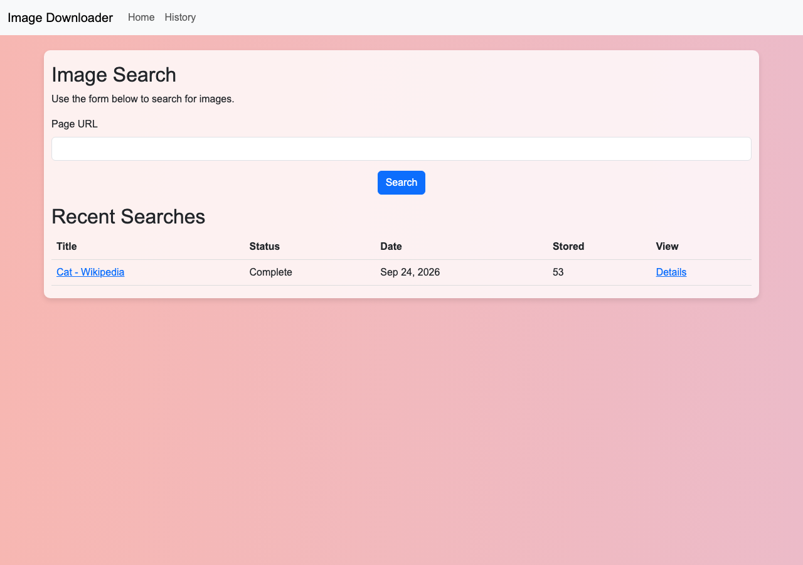
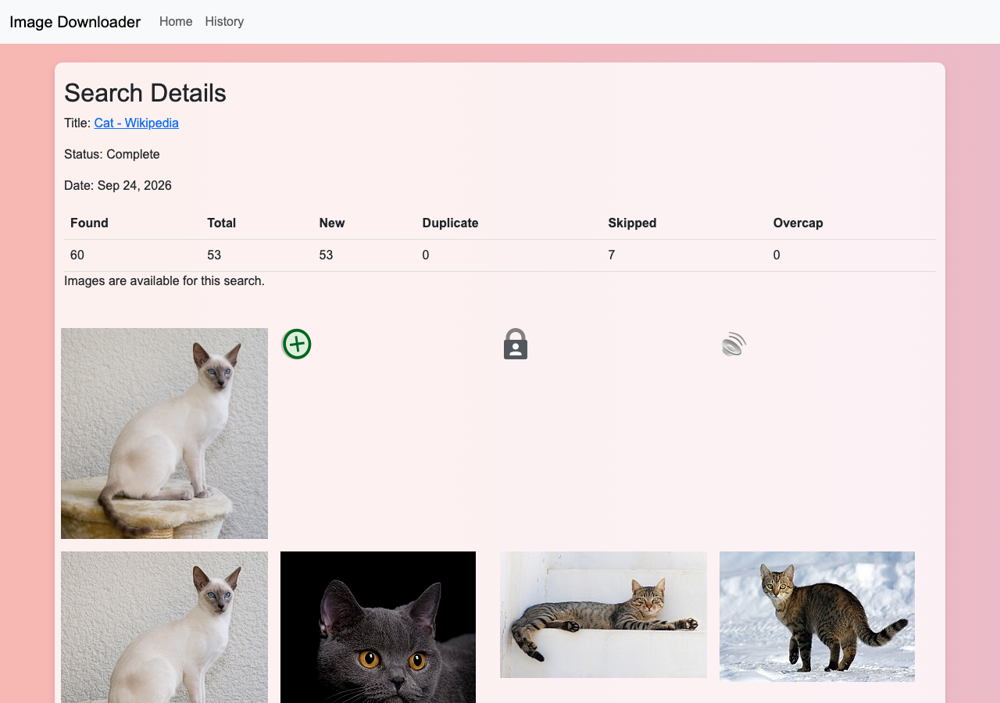
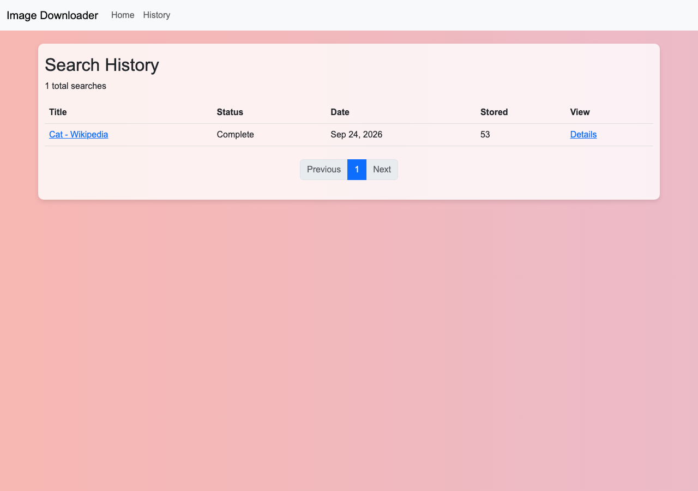

# Django Image Scraper

A Django and PostgreSQL web app that takes a URL, downloads every image on that
page, shows them in a gallery and keeps a browsable history of past searches.

Built by **Christian Matsoukis** as a take-home exercise for a software
developer interview. The brief asked for four things:

1. Let the user enter a URL.
2. Download and display all of the images found at that URL.
3. Save the searched URL and references to the downloaded files in a relational database.
4. Provide a navigable list of past searches that redisplays their images.

All four work. Most of the effort went past the brief, into safe fetching,
de-duplicating storage and a fast, network-free test suite. The panel was told
to look at code structure and decisions more than the UI, so this README
covers those too.

# Screenshots

### Home: enter a URL and see recent searches



### Search details: per-search counts and the downloaded gallery



### History: paginated list of past searches



***

# Highlights

**Safe outbound fetching** ([fetching.py](img_downloader/fetching.py))
- Before any request, the hostname is resolved and rejected if it points to a
  private, loopback, link-local or reserved address. This is SSRF protection: a
  user can't make the server fetch from internal hosts.
- Redirects are followed by hand (`allow_redirects=False`, at most 5), so every
  hop is checked again rather than only the first URL.
- Every request has a connect timeout, a read timeout and a byte cap: 2 MB for
  HTML, 10 MB per image, 500 KB for `robots.txt`.
- The app checks `robots.txt` and sends its own `User-Agent`.
- SVG is refused on purpose to prevent stored XSS. The reasoning is below
  under [SVG and other vector formats](#svg-and-other-vector-formats).

**Thorough image discovery** ([parsing.py](img_downloader/parsing.py))
- Finds `og:image` meta tags, `` tags and `<picture><source>` tags in
  document order.
- Parses `srcset` by hand and keeps the highest-resolution candidate (`w` or
  `x` descriptors).
- Skips `<source>` tags inside `<video>` and `<audio>`, and makes every URL
  absolute against the page.

**Content-addressed storage** ([models.py](img_downloader/models.py), [ingest.py](img_downloader/ingest.py))
- `Search` → `SearchImage` → `ImageAsset`. Each asset is keyed by the SHA-256
  of its bytes, and that hash also names the file on disk. An image that
  appears on many pages, or many times on one page, is stored once and linked
  from each search.
- Every downloaded file is decoded with Pillow. Files that aren't really images
  and decompression bombs are both rejected.
- Each search records how many images were found, stored, newly downloaded,
  duplicated, skipped and cut off by the cap, so the gallery explains why it
  shows what it shows.
- Images download in parallel on a bounded thread pool. Database writes happen
  in a single transaction.

**Query-conscious views** ([views.py](img_downloader/views.py))
- The detail page uses `prefetch_related` and the history page uses a `Count`
  annotation, so neither page runs one query per row (the N+1 problem). Tests
  pin both query counts.

## Tech stack

Python 3.12 · Django 6 · PostgreSQL (psycopg 3) · Requests · Beautiful Soup ·
Pillow · Bootstrap · uv

## Project layout

```
img_downloader/
  fetching.py   HTTP layer: SSRF guard, redirects, robots.txt, size/time limits
  parsing.py    HTML → page title and absolute image URLs
  ingest.py     Orchestrates a search: fetch, download, hash, store, link
  models.py     Search, SearchImage, ImageAsset
  views.py      index / create / detail / history
  forms.py      URL form
  templates/    Bootstrap templates
  tests/        fetching, ingest and view tests, plus a fake network (fakes.py)
```

***

# Running it locally

Requires Python 3.12+, [uv](https://docs.astral.sh/uv/) and a local PostgreSQL server.

```bash
git clone https://github.com/christian4423/Django-Image-Scrapper.git
cd Django-Image-Scrapper
uv sync
source .venv/bin/activate
```

## Database

`settings.py` reads its connection details from a PostgreSQL service file
instead of storing credentials in the repo:

```python
DATABASES = {
    "default": {
        "ENGINE": "django.db.backends.postgresql",
        "OPTIONS": {
            "service": "img_downloader",
            "passfile": str(Path.home() / ".my_pgpass"),
        },
    }
}
```

Create `~/.pg_service.conf`:

```
[img_downloader]
host=localhost
user=postgres
dbname=img_downloader
port=5432
```

Create `~/.my_pgpass` in the format `host:port:database:user:password`:

```
localhost:5432:img_downloader:postgres:YOUR_PASSWORD
```

Lock both files down, then create the database:

```bash
chmod 600 ~/.my_pgpass ~/.pg_service.conf
psql -U postgres -c "CREATE DATABASE img_downloader;"
```

## Run

```bash
python manage.py migrate
python manage.py runserver
```

Then open <http://127.0.0.1:8000/> and try a page such as
`https://en.wikipedia.org/wiki/Cat`.

***

# Running the tests

```
python manage.py test
```

77 tests, under a second, and no network access — `img_downloader/tests/fakes.py`
stands in for the internet, so a 404, a redirect loop, a link-local address or a
dropped connection are all reproducible rather than dependent on some real site
behaving that way today.

The `fetching` tests need no database and run as `SimpleTestCase`. The `ingest`
tests drive the real `fetch_page` and `download_image` over that fake network
instead of stubbing them, so the seam between the two modules is covered: a 404
on one image has to travel from `requests`, through error translation, to a
skipped image on a search that still completes.

The `views` tests drive the same stack through Django's test client, so routing,
the form and the templates all run. Two of them assert query *counts* rather
than HTML: `detail` and `history` are each written in a particular shape to
avoid an N+1 — `prefetch_related` on one, a `Count` annotation on the other —
and an assertion about the rendered page would pass just as happily against the
slow version. Both are pinned at two different row counts, so a count that grows
with the data fails the build.

***

# Ideas for Further Development

Known limitations and where I would take the application next.

## Orphaned files from rolled-back ingests

`ImageAsset.file.save()` writes to storage the moment it is called, but it runs
inside the `transaction.atomic()` block in `ingest_url`. Storage is not
transactional: when the transaction rolls back, the database row disappears and
the bytes on disk stay, referenced by nothing. The same asymmetry applies in
reverse — `ImageAsset.objects.all().delete()` drops rows and leaves every file
in place.

The usual fix, deferring the write with `transaction.on_commit()`, does not fit
here. `ImageAsset.file` declares `width_field`/`height_field`, so Django reads
the image to populate its dimensions *during* the save; the file has to exist
before the row can be written. Deferring the write would only invert the
failure — a crash between commit and callback would leave a row with no file,
which is worse, because the application would then serve a broken image rather
than waste a few kilobytes of disk.

I would instead treat drift between the two stores as expected and reconcile
it: a management command that walks `MEDIA_ROOT` and deletes any file with no
matching `ImageAsset`. Because the path is derived from the content hash, each
check is one indexed lookup, and the same command cleans up after deletes.
Run it from cron.

## Politeness limits on outbound requests

Images are downloaded in parallel through a `ThreadPoolExecutor` bounded at
`MAX_DOWNLOAD_WORKERS`, but that is a global cap, not a per-host one. It behaves
like a per-host cap in practice, because a page's images almost always come from
one or two origins — but a page that fans out across many hosts could open eight
connections to each of them. Keying a semaphore on the hostname would make the
limit mean what it says.

Relatedly, `robots.txt` is fetched and parsed but only `can_fetch` is consulted.
`Crawl-delay` is sitting right there in the parsed result and is ignored.

## Moving ingest off the request cycle

Even parallelized, fetching a page and its images is too slow to do inside an
HTTP request. `Search.Status` is already shaped for the alternative: `PENDING`
exists precisely so a row can be created and returned immediately while the
work happens elsewhere. A task queue (Celery, RQ, django-q) would take the
`Search` id, and the detail page would poll or subscribe until the status
flips. The current synchronous `ingest_url` then becomes the body of the task.

## Listing which images failed, and why

`Search` records how many images were found, skipped, deduplicated and cut off
by the cap, which is enough for the gallery to explain itself. What it does not
record is *which* URLs failed and for what reason — that only reaches the log.

A `SkippedImage` table (search, source_url, reason, detail) would let a detail
view list them. It was left out on purpose: the counters answer the question a
user actually asks, and a separate table can be added later without changing
what `search.images` means to templates already written against it.

## SVG and other vector formats

SVG is rejected deliberately, at the content-type check, and that is a security
decision rather than a gap. SVG is an active-content format — it can carry
`<script>`, event handlers and external references, all of which a browser
executes — and assets are served back from our own origin, so storing one would
be stored XSS: a page we ingested could run JavaScript against our own users'
sessions. Refusing on the declared type also means the body is never
downloaded. Because a server can mislabel an SVG as `image/png`, the Pillow
decode in `ingest.py` is kept as a second line.

On the Wikipedia test page that accounts for 7 of 59 images, which is a real
cost: those are logos and icons a user would expect to see. Supporting them
safely means either rasterizing at ingest with something like `cairosvg`, or a
separate model backed by a plain `FileField` with the SVG sanitized and served
from a separate origin — not just `FileField` on its own, which would reproduce
exactly the vulnerability above.

## Race on asset creation

`ImageAsset.objects.filter(sha256=digest).first()` followed by a create is
check-then-act. Downloads already run in parallel, but this step does not: once
they finish, `_save_assets` looks up and stores each image one at a time, so a
single search cannot race with itself.

Two searches can. If two pages that share an image are ingested at the same
moment, both lookups miss, both insert, and one fails the `sha256` unique
constraint, rolling back that search's whole transaction. That is reachable
whenever requests are served concurrently, as they would be by multiple
threads, multiple workers, or a task queue. `get_or_create`, or an explicit
`INSERT ... ON CONFLICT DO NOTHING`, closes it.

## Smaller items

- The `robots.txt` cache is an `lru_cache` with no expiry, so a long-running
  process never notices a change. Fine for one-shot ingests, wrong for a
  persistent worker.
- SSRF protection resolves the hostname and then lets `requests` resolve it
  again when connecting, leaving a DNS-rebinding window. Closing it properly
  means pinning the validated IP for the connection.
- `MAX_IMAGES`, the byte caps and the timeouts are module constants; they
  belong in settings so they can be tuned per environment.
